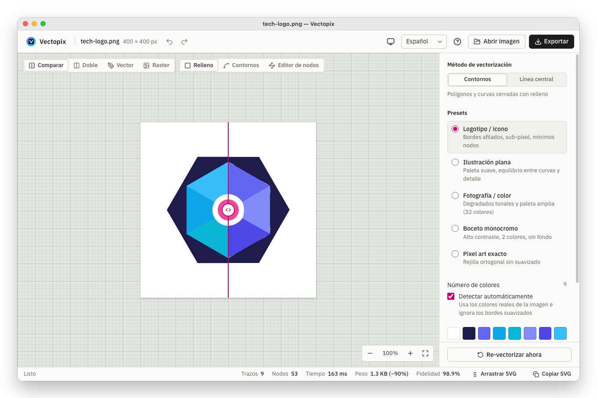
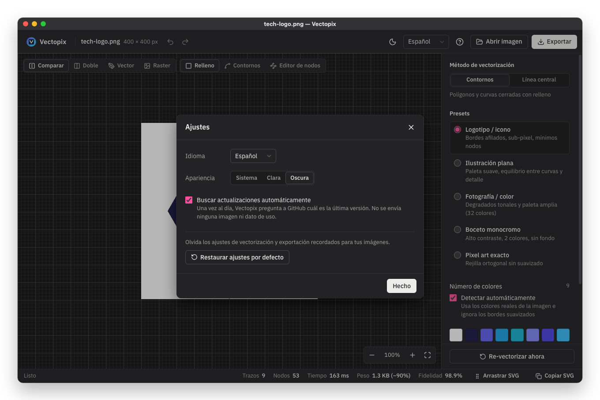

<p align="center">
  
</p>

<h1 align="center">Vectopix</h1>

<p align="center">
  <a href="README.md">English</a> · <b>Español</b>
</p>

<p align="center">
  Convierte imágenes raster (PNG, JPG, WebP, BMP) en vectores limpios — <b>SVG, DXF, EPS y PDF</b>.
  Funciona por completo en tu equipo, en el navegador o como app de escritorio: tus imágenes nunca salen de tu ordenador.
</p>

<p align="center">
  <a href="https://github.com/jgestal/Vectopix/actions/workflows/ci.yml"></a>
  <a href="https://github.com/jgestal/Vectopix/releases/latest"></a>
  
  
</p>

<p align="center">
  <a href="https://jgestal.github.io/Vectopix/"><b>▶ Probar en el navegador</b></a>
  &nbsp;·&nbsp;
  <a href="https://github.com/jgestal/Vectopix/releases/latest"><b>⬇ Descargar para macOS, Windows y Linux</b></a>
</p>

<p align="center">
  
</p>

## Características

- **Un espacio de trabajo tranquilo y legible**: el lienzo es una alfombrilla de corte, los ajustes están en un solo panel con los avanzados plegados, y la interfaz es clara, oscura o sigue la de tu sistema (el botón junto al idioma, o Ajustes).
- **Geometría limpia, no píxeles calcados**: los bordes rectos salen como una sola recta, las esquinas son nítidas y los arcos son arcos de circunferencia de verdad. Un logo plano queda con los pocos nodos que dibujaría un diseñador: el logo hexagonal de ejemplo tiene unos 50 nodos en lugar de varios cientos.
- **Detección automática de colores**: encuentra los colores reales de la imagen y los usa tal cual, ignorando los píxeles mezclados del antialiasing, así que no se fusionan colores parecidos ni aparecen contornos fantasma. También con JPEG: los tonos casi idénticos que deja la compresión cuentan como un solo color.
- **Trazado sub-píxel** con [vecline](https://www.npmjs.com/package/vecline): cuantización de color en Oklab, reconstrucción del anti-aliasing, fronteras compartidas entre formas vecinas y detección de círculos, elipses y rectángulos. ImageTracerJS está disponible como motor alternativo.
- **Dos métodos de trazado**
  - *Contornos*: regiones de color rellenas, para logos, ilustraciones, pixel art o fotos.
  - *Línea central*: trazos de un solo hilo, para corte láser, plotters, CNC y bocetos.
- **Presets** para logotipos, ilustración plana, fotografía, bocetos, pixel art y línea central, más control fino de colores, tolerancia, suavizado, esquinas, área mínima, contraste y reducción de ruido.
- **Fondo transparente**: elimina el fondo que rodea al motivo y conserva ese mismo color dentro de él (el blanco de un logo sigue siendo blanco). El contorno se ajusta al borde real, sin halo. Un PNG que ya es transparente sigue siéndolo, y la opción se activa sola.
- **Sin grietas entre formas**: las formas que están dentro de otras se pintan sobre una forma entera, así que el fondo nunca asoma como una línea fina a ningún zoom.
- **Pixel art exacto**: el pixel art puede trazarse siguiendo su propia rejilla, con esquinas en ángulo recto.
- **Re-trazado automático**: al cambiar cualquier ajuste se vuelve a vectorizar (con *debounce*, así que mover un slider no satura el motor). Tus ediciones de nodos y colores no se pierden: quedan a un deshacer de distancia, junto con los ajustes con los que las hiciste.
- **Fidelidad medida, no estimada**: el SVG resultante se renderiza y se compara con la imagen original mediante SSIM.
- **Cualquier imagen, de cualquier forma**: arrastra o pega PNG, JPG, WebP, GIF, AVIF, BMP, ICO, SVG, TGA o PPM/PGM; arrastra una de las muestras o una imagen de otra página web a la zona de carga.
- **Comparación visual**: cortinilla antes/después, vista doble, solo vector o solo raster, modo contornos y rejilla de píxeles al hacer zoom.
- **Editor de nodos Bézier**: mueve anclas y tiradores, alterna curva/esquina, divide tramos, elimina nodos y simplifica trazados, con deshacer y rehacer. Admite todos los comandos de trazado SVG, arcos incluidos, y guarda las ediciones en formato compacto para que el archivo no engorde.
- **Gestión de paleta**: la caja de colores muestra la paleta del trazado; haz clic en un color para sustituirlo en todo el gráfico (degradados incluidos) o hacerlo transparente.
- **Exportación**: SVG optimizado, PNG a @1x–@8x, componentes React/Vue/Svelte, DXF (láser/CNC), EPS (imprenta) y PDF vectorial. Todos los formatos incluyen tus ediciones de nodos y colores. Copia el resultado como imagen PNG para pegarlo en cualquier app, o arrastra el SVG desde la barra de estado directamente a otra app o a una carpeta.
- **Recuerda tus preferencias**: los ajustes que eliges y cómo exportas se mantienen para la próxima vez. Las muestras incluidas traen su propio preset sin pisar el tuyo.
- **8 idiomas**: español, inglés, alemán, francés, italiano, portugués, chino y japonés. La app usa el idioma de tu sistema y recuerda tu elección.
- **Todo en local**: el motor corre en un Web Worker, así que la interfaz no se bloquea, y no se sube nada a ningún servidor. Las fuentes también van incluidas, así que la app de escritorio funciona sin conexión. La única petición que hace la app de escritorio es preguntar a GitHub, como mucho una vez al día, cuál es la última versión, para avisarte cuando haya una nueva (no se envía ninguna imagen ni dato de uso).

## Capturas

<table>
  <tr>
    <td width="50%"></td>
    <td width="50%"></td>
  </tr>
  <tr>
    <td align="center"><b>Portada</b>: arrastra, pega o prueba una muestra</td>
    <td align="center"><b>Editor de nodos</b>: anclas y tiradores Bézier</td>
  </tr>
  <tr>
    <td></td>
    <td></td>
  </tr>
  <tr>
    <td align="center"><b>Vista doble</b>: original y vector lado a lado</td>
    <td align="center"><b>Modo oscuro</b>: claro, oscuro o el de tu sistema</td>
  </tr>
  <tr>
    <td></td>
    <td></td>
  </tr>
  <tr>
    <td align="center"><b>Línea central</b>: trazos de un solo hilo para láser y CNC</td>
    <td align="center"><b>Exportación</b>: SVG, PNG, componentes, DXF, EPS y PDF</td>
  </tr>
</table>

### App de escritorio

<table>
  <tr>
    <td width="50%"></td>
    <td width="50%"></td>
  </tr>
  <tr>
    <td align="center"><b>macOS</b>: menús nativos y la ventana con el nombre de la imagen</td>
    <td align="center"><b>Ajustes</b> (<kbd>⌘,</kbd>): idioma, apariencia y actualizaciones</td>
  </tr>
</table>

## Descargas

Cada [versión publicada](https://github.com/jgestal/Vectopix/releases/latest) incluye:

| Plataforma | Archivo |
| --- | --- |
| macOS (Apple Silicon) | `Vectopix-<versión>-mac-arm64.dmg` |
| macOS (Intel) | `Vectopix-<versión>-mac-x64.dmg` |
| Windows | `Vectopix-<versión>-windows-setup.exe` (instalador) o `-windows-portable.exe` |
| Linux | `Vectopix-<versión>-linux-x86_64.AppImage` o `-linux-amd64.deb` |
| Web (para tu servidor) | `Vectopix-<versión>-web.zip`: súbelo a cualquier servidor web estático |

Las apps no están firmadas con un certificado de desarrollador de pago, así que el primer arranque pide confirmación:

- **macOS**: abre la app y ve a *Ajustes del Sistema → Privacidad y seguridad* → **Abrir igualmente**.
- **Windows**: en el aviso de SmartScreen pulsa **Más información → Ejecutar de todas formas**.
- **Linux**: haz ejecutable el AppImage (`chmod +x Vectopix-*.AppImage`) y ábrelo.

## Desarrollo

Requisitos: Node.js 20.19+ o 22.12+ (lo que pide Vite 8).

```bash
git clone https://github.com/jgestal/Vectopix.git
cd Vectopix
npm install
npm run dev
```

Abre la URL que muestra Vite (normalmente `http://localhost:5173`). Arrastra una imagen, pégala con <kbd>Ctrl</kbd>/<kbd>⌘</kbd>+<kbd>V</kbd> o prueba con una de las muestras incluidas.

| Comando                | Qué hace                                                    |
| ---------------------- | ----------------------------------------------------------- |
| `npm run dev`          | Servidor de desarrollo con HMR                              |
| `npm run build`        | Comprobación de tipos y build de producción en `dist/`      |
| `npm run preview`      | Sirve el build de producción                                |
| `npm test`             | Ejecuta los tests unitarios (Vitest)                        |
| `npm run test:e2e`     | Compila y ejecuta los tests de navegador (Playwright, Chromium) |
| `npm run test:coverage` | Tests unitarios y de integración con cobertura (umbrales por capa) |
| `npm run test:e2e:desktop` | Compila y ejecuta los tests de la app de escritorio (Electron, menús nativos) |
| `npm run lint`         | Lint con Oxlint                                             |
| `npm run desktop`      | Compila y abre la app de escritorio (Electron)              |
| `npm run dist:desktop` | Genera los instaladores de escritorio de tu sistema en `release/` |

### Publicar una versión

1. Sube la `version` en `package.json`, añade la sección de esa versión a [`CHANGELOG.md`](CHANGELOG.md) y haz commit.
2. Etiqueta el commit y sube la etiqueta: `git tag v1.2.3 && git push origin v1.2.3`.
3. El workflow **Release** compila las apps en macOS, Windows y Linux, más el zip web, y las publica como release de GitHub. Sus notas son la sección del CHANGELOG de esa versión más la tabla de descargas; una etiqueta sin sección en el CHANGELOG falla antes de compilar nada.

Para probar una release antes, lanza el workflow **Release** a mano (Actions → Release → Run workflow): compila todo en los tres sistemas y guarda los instaladores como artefactos del workflow, sin publicar nada.

Además, cada push a `main` pasa los tests unitarios y de navegador y despliega la versión web en GitHub Pages.

## Menús de la app de escritorio

La app de escritorio tiene una barra de menús nativa completa, en tu idioma, siguiendo las convenciones de cada sistema (menú de aplicación en macOS; Acerca de y Salir en Ayuda y Archivo en Windows y Linux):

| Menú | Qué contiene |
| ---- | ------------ |
| **Archivo** | Nuevo, Abrir imagen… <kbd>⌘O</kbd>, Abrir recientes (macOS), Imágenes de ejemplo, Guardar como SVG… <kbd>⌘S</kbd>, Exportar… <kbd>⌘E</kbd>, Copiar código SVG <kbd>⇧⌘C</kbd>, Copiar como PNG <kbd>⌥⌘C</kbd> |
| **Edición** | Deshacer / Rehacer, portapapeles, Simplificar nodos, Restaurar trazado original, Ajustes… (Windows, Linux) |
| **Visualización** | Comparar / Doble / Solo vector / Solo original <kbd>⌘1</kbd>–<kbd>⌘4</kbd>, Relleno / Contornos / Editor de nodos, zoom <kbd>⌘+</kbd> <kbd>⌘−</kbd> <kbd>⌘0</kbd> <kbd>⌘9</kbd>, pantalla completa |
| **Imagen** | Preset, método de vectorización, colores automáticos, fondo transparente, Re-vectorizar ahora <kbd>⌘R</kbd> |
| **Ayuda** | Atajos de teclado, novedades de la versión, la versión web, el código fuente, Informar de un problema… |

Las opciones se activan y se marcan según lo que hay en pantalla. **Ajustes…** (<kbd>⌘,</kbd>) contiene las preferencias de la propia app: idioma, apariencia (clara, oscura o la del sistema, menús y diálogos incluidos), búsqueda automática de actualizaciones y restaurar los ajustes recordados.

La app se comporta como el resto de tu escritorio: Guardar y Exportar usan el diálogo de guardado del sistema, empezando en la última carpeta usada; la ventana lleva el nombre de la imagen (con el punto de cambios sin guardar en macOS) y se vuelve a abrir donde la dejaste; el icono del Dock o de la barra de tareas muestra el progreso de la vectorización. Al instalarla, Vectopix aparece en «Abrir con» para imágenes PNG, JPG, WebP, GIF, BMP, TGA e ICO, sin convertirse en su app predeterminada. Los archivos abiertos desde el Dock, el Finder o «Abrir con» se cargan directamente, y cerrar la ventana con ediciones sin guardar pide confirmación. En Windows y Linux, <kbd>⌘</kbd> es <kbd>Ctrl</kbd>.

**Acerca de Vectopix** — Vectopix está hecho por **Juan Gestal** · [gestal.es](https://gestal.es) · [juan@gestal.es](mailto:juan@gestal.es)

## Atajos de teclado

| Atajo                                   | Acción                                        |
| --------------------------------------- | --------------------------------------------- |
| <kbd>⌘/Ctrl</kbd> + <kbd>Z</kbd>        | Deshacer                                      |
| <kbd>⌘/Ctrl</kbd> + <kbd>⇧</kbd> + <kbd>Z</kbd> · <kbd>⌘/Ctrl</kbd> + <kbd>Y</kbd> | Rehacer |
| <kbd>⌘/Ctrl</kbd> + <kbd>C</kbd>        | Copiar el SVG (si no hay texto seleccionado)  |
| <kbd>⌘/Ctrl</kbd> + <kbd>V</kbd>        | Cargar una imagen desde el portapapeles       |
| <kbd>N</kbd> / <kbd>E</kbd>             | Editor de nodos                               |
| <kbd>W</kbd>                            | Modo contornos (wireframe)                    |
| <kbd>S</kbd>                            | Alternar cortinilla / solo vector             |
| <kbd>D</kbd>                            | Vista doble lado a lado                       |
| <kbd>Espacio</kbd> + arrastrar          | Desplazar el lienzo                           |
| Rueda / pellizco                        | Zoom centrado en el cursor                    |
| <kbd>Supr</kbd> / <kbd>⌫</kbd>          | Eliminar el nodo seleccionado                 |
| <kbd>F1</kbd> / <kbd>?</kbd>            | Mostrar todos los atajos                      |

## Arquitectura

```
src/
├── domain/                     Reglas puras: sin librerías, sin APIs del navegador, sin React
│   ├── geometry/               Datos de trazado SVG, modelo de documento, edición de nodos, simplificación
│   ├── vectorization/          Reajuste geométrico, apilado sin grietas, quitar el fondo, rejilla de píxeles
│   ├── palette/                Selección de colores reales (ruido JPEG, mezclas de antialiasing), recoloreado
│   ├── raster/                 Detección de recortes y de pixel art
│   └── …                       Presets, historial, ediciones del dibujo, atajos, nombres de exportación
├── application/                Casos de uso y los puertos que necesitan (ports.ts)
│   ├── vectorizeImage.ts       Paleta → estrategia de trazado → pasos de limpieza
│   ├── prepareImage.ts         Decodificar, reducir, avisos
│   ├── preferences.ts          Ajustes recordados, validados al leerlos
│   └── checkForUpdate.ts       Aviso de nueva versión de la app de escritorio
├── infrastructure/             Adaptadores que implementan los puertos
│   ├── vecline/, imagetracer/  Motores de trazado; engine.ts los monta para el worker
│   ├── worker/                 Web Worker y su cliente (cancelación, progreso)
│   ├── browser/                Carga de imágenes, canvas, descargas, parser XML
│   ├── storage/, github/       localStorage, consulta de la última versión
│   └── drawingExporter.ts      PNG, componentes, DXF / EPS / PDF
├── ui/                         React: App, componentes, hooks
│   ├── compositionRoot.ts      El único sitio que construye los servicios concretos
│   └── services/               El contrato de servicios inyectados (AppServices)
└── i18n/                       Traducciones: runtime ligero, un archivo por idioma
tests/
├── architecture/               Regla de dependencias: apuntan hacia dentro
└── e2e/                        Tests de navegador (Playwright)
electron/main.cjs               App de escritorio: sirve dist/ desde un origen privado app://
```

**Capas y pruebas.** Las dependencias apuntan hacia dentro: la interfaz y los adaptadores dependen de los casos de uso, los casos de uso del dominio, y el dominio de nada. Un test lo comprueba en cada import (y mantiene las APIs del navegador fuera de las capas internas). La interfaz recibe sus servicios por inyección de dependencias, así que los tests la ejecutan sobre fakes. Pruebas por capa: reglas del dominio y casos de uso con fakes (unitarias), adaptadores contra las librerías reales (integración), componentes y la app entera sobre servicios falsos (React Testing Library) y los flujos críticos en un navegador real (Playwright). La CI exige cobertura por capa y un límite de complejidad ciclomática de 10.

**Cómo fluye una vectorización**

1. La imagen se decodifica en un `<canvas>`. Si supera los 4 MP se reduce, para que el trazado siga siendo fluido.
2. Los píxeles se envían (transferidos, sin copias) al Web Worker, que aplica el preprocesado, detecta los colores reales y traza con vecline o ImageTracerJS mientras informa del progreso.
3. Los contornos trazados se reajustan: cada uno se remuestrea, se localizan sus esquinas reales (giros bruscos, o dos tramos rectos que se encuentran en ángulo) y cada tramo entre esquinas se redibuja como una sola recta, un arco de circunferencia o el menor número posible de curvas Bézier. Donde se juntan dos rectas, la esquina pasa a su intersección exacta. Si el reajuste se aleja de la forma trazada, se descarta y ese contorno se queda tal como se trazó.
4. Las formas cuyo hueco rellenan por completo otras formas se dibujan enteras, con esas formas encima (sin grietas finas). Con fondo transparente, se elimina después la región del color de fondo que toca el borde de la imagen, conservando ese color dentro del motivo.
5. Si llega una petición nueva mientras otra está en curso, el worker se termina y se crea uno nuevo. Es una cancelación real: el trabajo antiguo no sigue consumiendo CPU.
6. Con el SVG ya en pantalla, se renderiza en segundo plano y el worker calcula su SSIM frente al original.
7. DXF, EPS y PDF se generan a partir del SVG actual al abrir su pestaña de exportación, así que comparten su geometría limpia e incluyen cualquier edición.

**Traducciones**: `src/i18n/locales/es.ts` es el catálogo de referencia. TypeScript obliga a que cada idioma defina exactamente las mismas claves, y un test comprueba que cada traducción conserve los mismos `{marcadores}`. Para añadir un idioma, copia `en.ts`, tradúcelo y regístralo en `src/i18n/core.ts`.

## Limitaciones conocidas

- Al exportar a DXF, EPS o PDF desde un SVG editado, los degradados se aplanan al color medio de sus paradas y no se aplican atributos `transform` (los SVG que genera la app no los usan).
- Las imágenes muy pequeñas (por debajo de unos 100 px) se trazan con menos fidelidad: los detalles finos ocupan solo unos píxeles. Usa la versión más grande del logo que tengas; la app te lo indica al cargarla.
- El SSIM se mide a un máximo de 512 px en el lado mayor: es un indicador fiable de fidelidad, no una comparación a resolución completa.

## Tecnologías

[React 19](https://react.dev) · [TypeScript](https://www.typescriptlang.org) · [Vite](https://vite.dev) · [vecline](https://www.npmjs.com/package/vecline) · [ImageTracerJS](https://github.com/jankovicsandras/imagetracerjs) · [Electron](https://www.electronjs.org) · [Lucide](https://lucide.dev) · [IBM Plex](https://www.ibm.com/plex/) · [Vitest](https://vitest.dev) · [Oxlint](https://oxc.rs)

## Licencia

[MIT](LICENSE) © 2026 Juan Gestal
