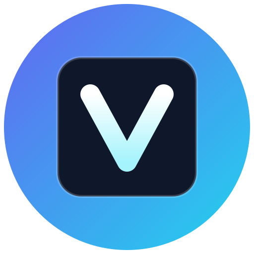
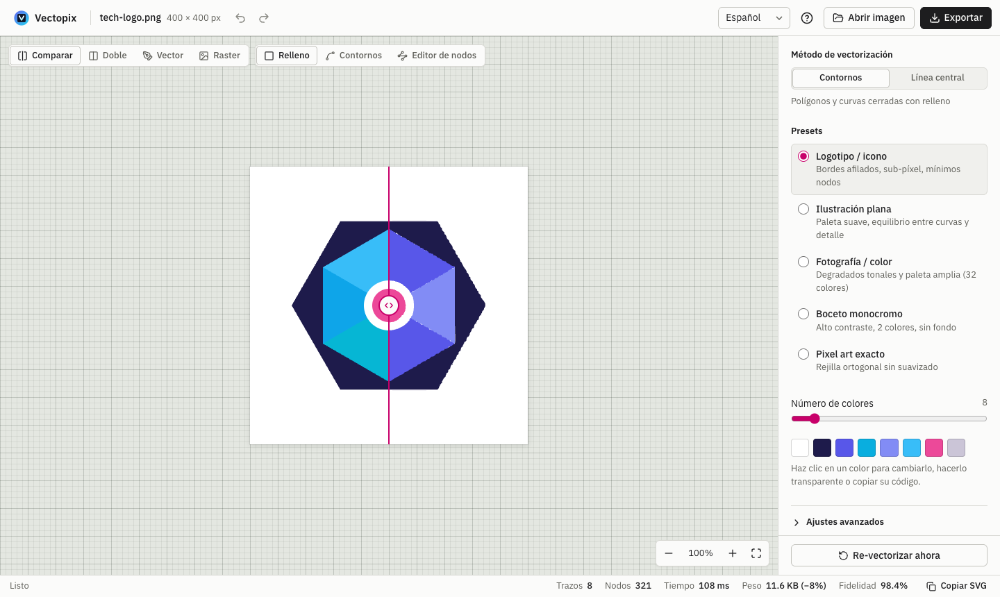
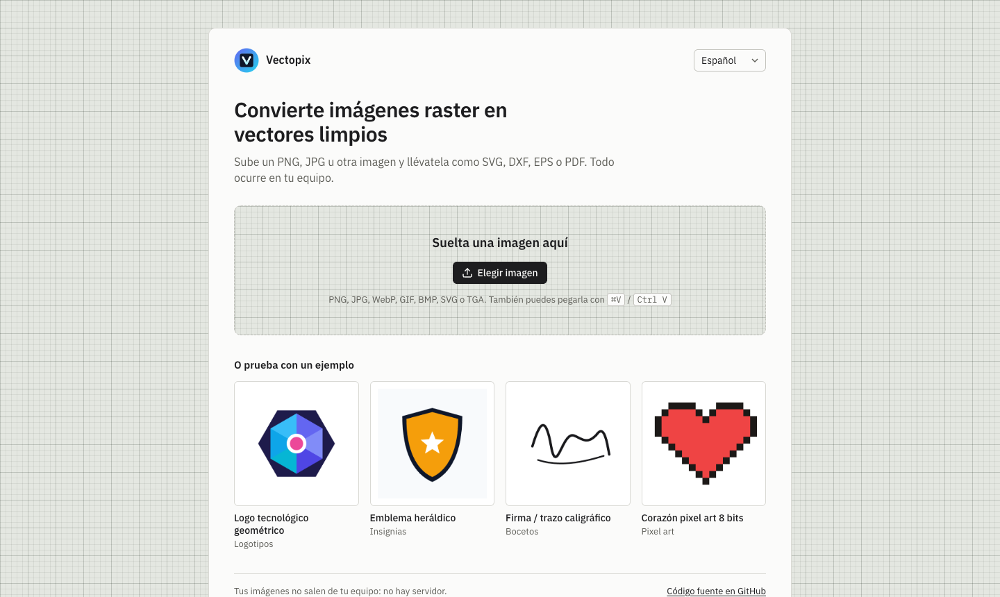
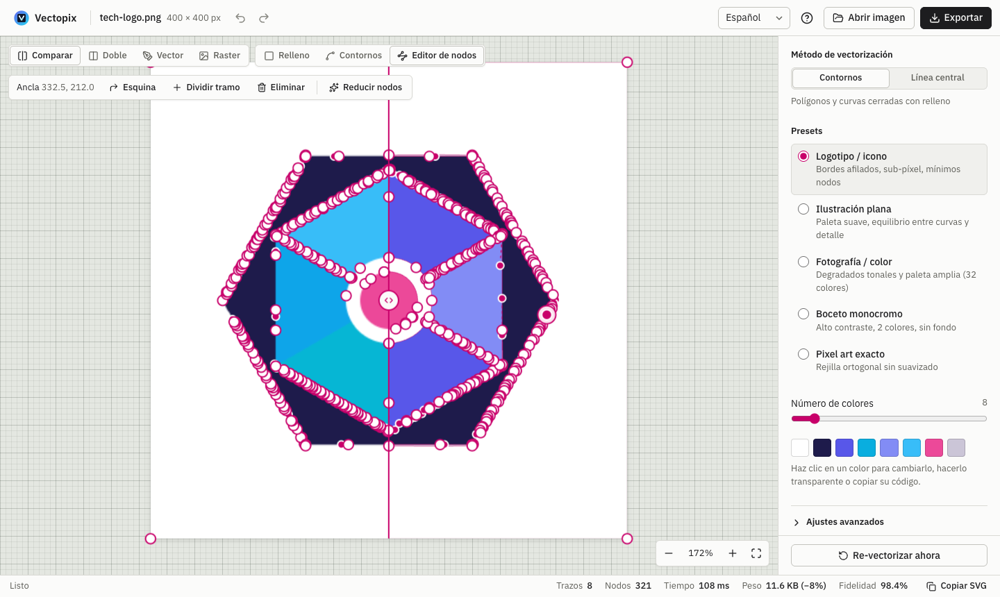
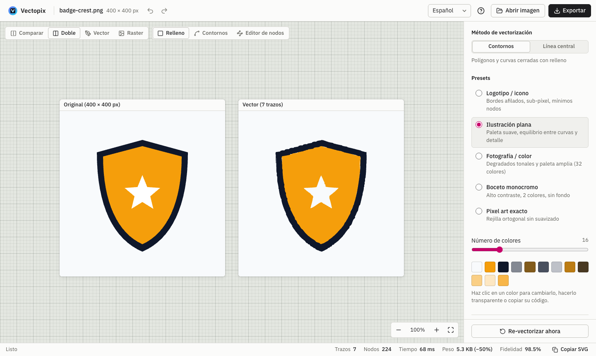
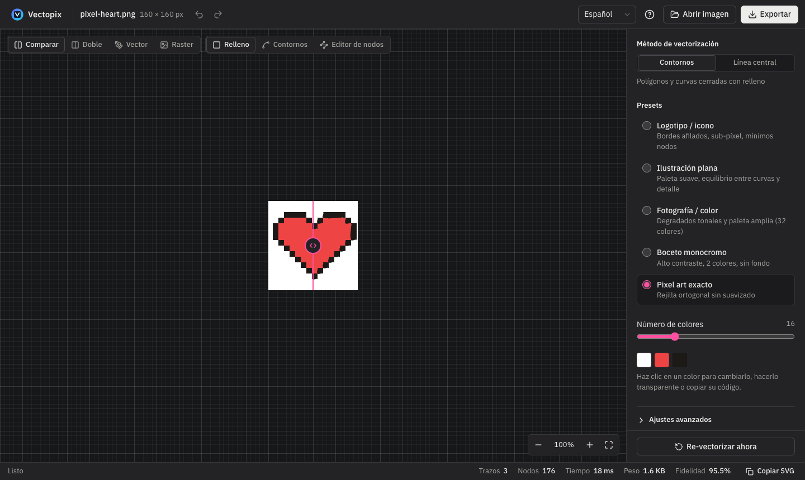
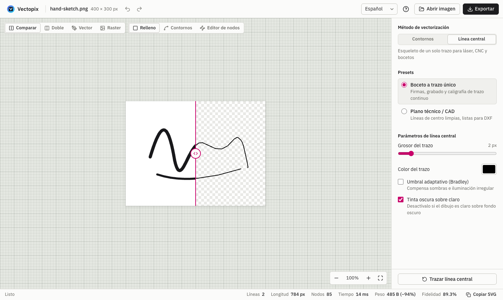
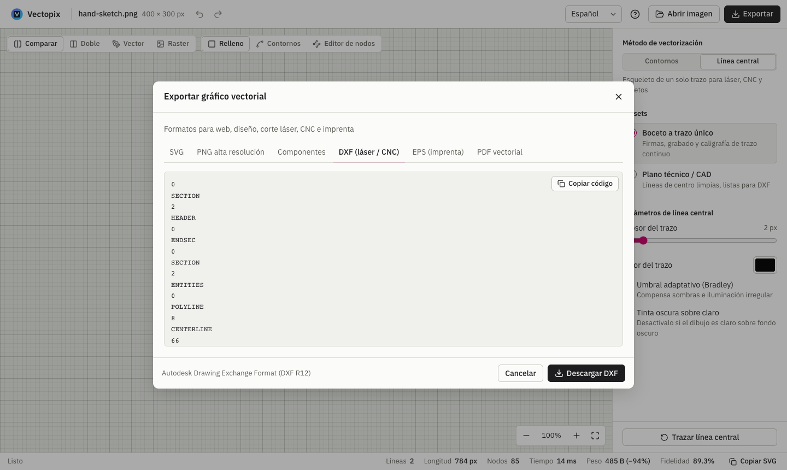

<p align="center">
  
</p>

<h1 align="center">Vectopix</h1>

<p align="center">
  <a href="README.md">English</a> · <b>Español</b>
</p>

<p align="center">
  Convierte imágenes raster (PNG, JPG, WebP, BMP) en vectores limpios — <b>SVG, DXF, EPS y PDF</b>.
  Funciona por completo en tu equipo, en el navegador o como app de escritorio: tus imágenes nunca salen de tu ordenador.
</p>

<p align="center">
  <a href="https://github.com/jgestal/Vectopix/actions/workflows/ci.yml"></a>
  <a href="https://github.com/jgestal/Vectopix/releases/latest"></a>
  
  
</p>

<p align="center">
  <a href="https://jgestal.github.io/Vectopix/"><b>▶ Probar en el navegador</b></a>
  &nbsp;·&nbsp;
  <a href="https://github.com/jgestal/Vectopix/releases/latest"><b>⬇ Descargar para macOS, Windows y Linux</b></a>
</p>

<p align="center">
  
</p>

## Características

- **Un espacio de trabajo tranquilo y legible**: el lienzo es una alfombrilla de corte, los ajustes están en un solo panel con los avanzados plegados, y la interfaz sigue el modo claro u oscuro de tu sistema.
- **Vectorización sub-píxel** con [vecline](https://www.npmjs.com/package/vecline): cuantización de color en espacio Oklab, reconstrucción del anti-aliasing y ajuste de curvas Bézier. ImageTracerJS está disponible como motor alternativo.
- **Dos métodos de trazado**
  - *Contornos*: regiones de color rellenas, para logos, ilustraciones, pixel art o fotos.
  - *Línea central*: trazos de un solo hilo, para corte láser, plotters, CNC y bocetos.
- **Presets** para logotipos, ilustración plana, fotografía, bocetos, pixel art y línea central, más control fino de colores, tolerancia, suavizado, esquinas, área mínima, contraste y reducción de ruido.
- **Re-trazado automático**: al cambiar cualquier ajuste se vuelve a vectorizar (con *debounce*, así que mover un slider no satura el motor).
- **Fidelidad medida, no estimada**: el SVG resultante se renderiza y se compara con la imagen original mediante SSIM.
- **Cualquier imagen, de cualquier forma**: arrastra o pega PNG, JPG, WebP, GIF, AVIF, BMP, ICO, SVG, TGA o PPM/PGM; arrastra una de las muestras o una imagen de otra página web a la zona de carga.
- **Comparación visual**: cortinilla antes/después, vista doble, solo vector o solo raster, modo contornos y rejilla de píxeles al hacer zoom.
- **Editor de nodos Bézier**: mueve anclas y tiradores, alterna curva/esquina, divide tramos, elimina nodos y simplifica trazados, con deshacer y rehacer. Admite todos los comandos de trazado SVG, arcos incluidos, y guarda las ediciones en formato compacto para que el archivo no engorde.
- **Gestión de paleta**: la caja de colores muestra la paleta del trazado; haz clic en un color para sustituirlo en todo el gráfico (degradados incluidos) o hacerlo transparente.
- **Exportación**: SVG optimizado, PNG a @1x–@8x, componentes React/Vue/Svelte, DXF (láser/CNC), EPS (imprenta) y PDF vectorial. Todos los formatos incluyen tus ediciones de nodos y colores.
- **8 idiomas**: español, inglés, alemán, francés, italiano, portugués, chino y japonés. La app usa el idioma de tu sistema y recuerda tu elección.
- **Todo en local**: el motor corre en un Web Worker, así que la interfaz no se bloquea, y no se sube nada a ningún servidor. Las fuentes también van incluidas, así que la app de escritorio funciona sin conexión.

## Capturas

<table>
  <tr>
    <td width="50%"></td>
    <td width="50%"></td>
  </tr>
  <tr>
    <td align="center"><b>Portada</b>: arrastra, pega o prueba una muestra</td>
    <td align="center"><b>Editor de nodos</b>: anclas y tiradores Bézier</td>
  </tr>
  <tr>
    <td></td>
    <td></td>
  </tr>
  <tr>
    <td align="center"><b>Vista doble</b>: original y vector lado a lado</td>
    <td align="center"><b>Modo oscuro</b>: sigue la configuración de tu sistema</td>
  </tr>
  <tr>
    <td></td>
    <td></td>
  </tr>
  <tr>
    <td align="center"><b>Línea central</b>: trazos de un solo hilo para láser y CNC</td>
    <td align="center"><b>Exportación</b>: SVG, PNG, componentes, DXF, EPS y PDF</td>
  </tr>
</table>

## Descargas

Cada [versión publicada](https://github.com/jgestal/Vectopix/releases/latest) incluye:

| Plataforma | Archivo |
| --- | --- |
| macOS (Apple Silicon) | `Vectopix-<versión>-mac-arm64.dmg` |
| macOS (Intel) | `Vectopix-<versión>-mac-x64.dmg` |
| Windows | `Vectopix-<versión>-windows-setup.exe` (instalador) o `-windows-portable.exe` |
| Linux | `Vectopix-<versión>-linux-x86_64.AppImage` o `-linux-amd64.deb` |
| Web (para tu servidor) | `Vectopix-<versión>-web.zip`: súbelo a cualquier servidor web estático |

Las apps no están firmadas con un certificado de desarrollador de pago, así que el primer arranque pide confirmación:

- **macOS**: abre la app y ve a *Ajustes del Sistema → Privacidad y seguridad* → **Abrir igualmente**.
- **Windows**: en el aviso de SmartScreen pulsa **Más información → Ejecutar de todas formas**.
- **Linux**: haz ejecutable el AppImage (`chmod +x Vectopix-*.AppImage`) y ábrelo.

## Desarrollo

Requisitos: Node.js 20.19+ o 22.12+ (lo que pide Vite 8).

```bash
git clone https://github.com/jgestal/Vectopix.git
cd Vectopix
npm install
npm run dev
```

Abre la URL que muestra Vite (normalmente `http://localhost:5173`). Arrastra una imagen, pégala con <kbd>Ctrl</kbd>/<kbd>⌘</kbd>+<kbd>V</kbd> o prueba con una de las muestras incluidas.

| Comando                | Qué hace                                                    |
| ---------------------- | ----------------------------------------------------------- |
| `npm run dev`          | Servidor de desarrollo con HMR                              |
| `npm run build`        | Comprobación de tipos y build de producción en `dist/`      |
| `npm run preview`      | Sirve el build de producción                                |
| `npm test`             | Ejecuta los tests (Vitest)                                  |
| `npm run lint`         | Lint con Oxlint                                             |
| `npm run desktop`      | Compila y abre la app de escritorio (Electron)              |
| `npm run dist:desktop` | Genera los instaladores de escritorio de tu sistema en `release/` |

### Publicar una versión

1. Sube la `version` en `package.json` y haz commit.
2. Etiqueta el commit y sube la etiqueta: `git tag v1.2.3 && git push origin v1.2.3`.
3. El workflow **Release** compila las apps en macOS, Windows y Linux, más el zip web, y las publica como release de GitHub.

Además, cada push a `main` pasa los tests y despliega la versión web en GitHub Pages.

## Atajos de teclado

| Atajo                                   | Acción                                        |
| --------------------------------------- | --------------------------------------------- |
| <kbd>⌘/Ctrl</kbd> + <kbd>Z</kbd>        | Deshacer                                      |
| <kbd>⌘/Ctrl</kbd> + <kbd>⇧</kbd> + <kbd>Z</kbd> · <kbd>⌘/Ctrl</kbd> + <kbd>Y</kbd> | Rehacer |
| <kbd>⌘/Ctrl</kbd> + <kbd>C</kbd>        | Copiar el SVG (si no hay texto seleccionado)  |
| <kbd>⌘/Ctrl</kbd> + <kbd>V</kbd>        | Cargar una imagen desde el portapapeles       |
| <kbd>N</kbd> / <kbd>E</kbd>             | Editor de nodos                               |
| <kbd>W</kbd>                            | Modo contornos (wireframe)                    |
| <kbd>S</kbd>                            | Alternar cortinilla / solo vector             |
| <kbd>D</kbd>                            | Vista doble lado a lado                       |
| <kbd>Espacio</kbd> + arrastrar          | Desplazar el lienzo                           |
| Rueda / pellizco                        | Zoom centrado en el cursor                    |
| <kbd>Supr</kbd> / <kbd>⌫</kbd>          | Eliminar el nodo seleccionado                 |
| <kbd>F1</kbd> / <kbd>?</kbd>            | Mostrar todos los atajos                      |

## Arquitectura

```
src/
├── App.tsx                     Estado de la app: imagen, opciones, resultado, historial
├── i18n/                       Traducciones: runtime ligero, un archivo por idioma
├── config/presets.ts           Opciones por defecto y tabla única de presets
├── services/
│   ├── vectorEngine.ts         Motor puro (sin DOM ni worker): trazado, exportación y SSIM
│   └── vectorWorkerClient.ts   Cliente del worker: peticiones, progreso y cancelación
├── workers/vector.worker.ts    Envoltorio fino del motor dentro del Web Worker
├── components/                 Barra superior, controles del lienzo, Viewport (lienzo y editor de nodos), ajustes, diálogos…
│   └── ui/                     Piezas compartidas (diálogo)
└── utils/
    ├── pathParser.ts           Parser y editor de trazados SVG (anclas, tiradores, simplificación)
    ├── svgExport.ts            SVG (editado) → geometría para DXF / EPS / PDF
    ├── centerlineExport.ts     Escritores DXF / EPS / PDF para trazados de línea central
    ├── fidelity.ts             Renderiza el SVG para medir su fidelidad frente al original
    └── …                       Preprocesado, paleta, exportación y carga de imágenes
electron/main.cjs               App de escritorio: sirve dist/ desde un origen privado app://
```

**Cómo fluye una vectorización**

1. La imagen se decodifica en un `<canvas>`. Si supera los 4 MP se reduce, para que el trazado siga siendo fluido.
2. Los píxeles se envían (transferidos, sin copias) al Web Worker, que aplica el preprocesado y traza con vecline o ImageTracerJS mientras informa del progreso.
3. Si llega una petición nueva mientras otra está en curso, el worker se termina y se crea uno nuevo. Es una cancelación real: el trabajo antiguo no sigue consumiendo CPU.
4. Con el SVG ya en pantalla, se renderiza en segundo plano y el worker calcula su SSIM frente al original.
5. DXF, EPS y PDF solo se generan al abrir su pestaña de exportación: con la geometría exacta del trazado si no has editado nada, o a partir del SVG actual si lo has hecho, para incluir todos los cambios.

**Traducciones**: `src/i18n/locales/es.ts` es el catálogo de referencia. TypeScript obliga a que cada idioma defina exactamente las mismas claves, y un test comprueba que cada traducción conserve los mismos `{marcadores}`. Para añadir un idioma, copia `en.ts`, tradúcelo y regístralo en `src/i18n/core.ts`.

## Limitaciones conocidas

- Al exportar a DXF, EPS o PDF desde un SVG editado, los degradados se aplanan al color medio de sus paradas y no se aplican atributos `transform` (los SVG que genera la app no los usan).
- El SSIM se mide a un máximo de 512 px en el lado mayor: es un indicador fiable de fidelidad, no una comparación a resolución completa.

## Tecnologías

[React 19](https://react.dev) · [TypeScript](https://www.typescriptlang.org) · [Vite](https://vite.dev) · [vecline](https://www.npmjs.com/package/vecline) · [ImageTracerJS](https://github.com/jankovicsandras/imagetracerjs) · [Electron](https://www.electronjs.org) · [Lucide](https://lucide.dev) · [IBM Plex](https://www.ibm.com/plex/) · [Vitest](https://vitest.dev) · [Oxlint](https://oxc.rs)

## Licencia

[MIT](LICENSE) © 2026 Juan Gestal
