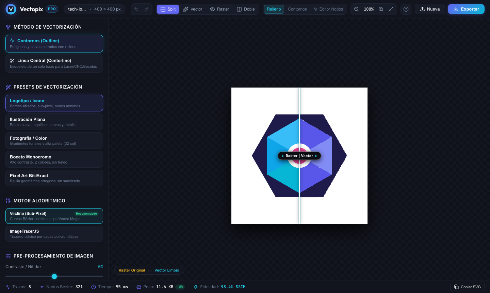
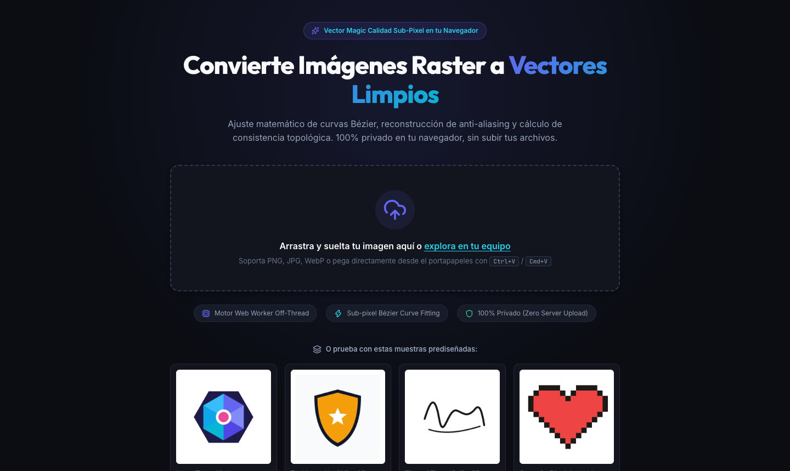
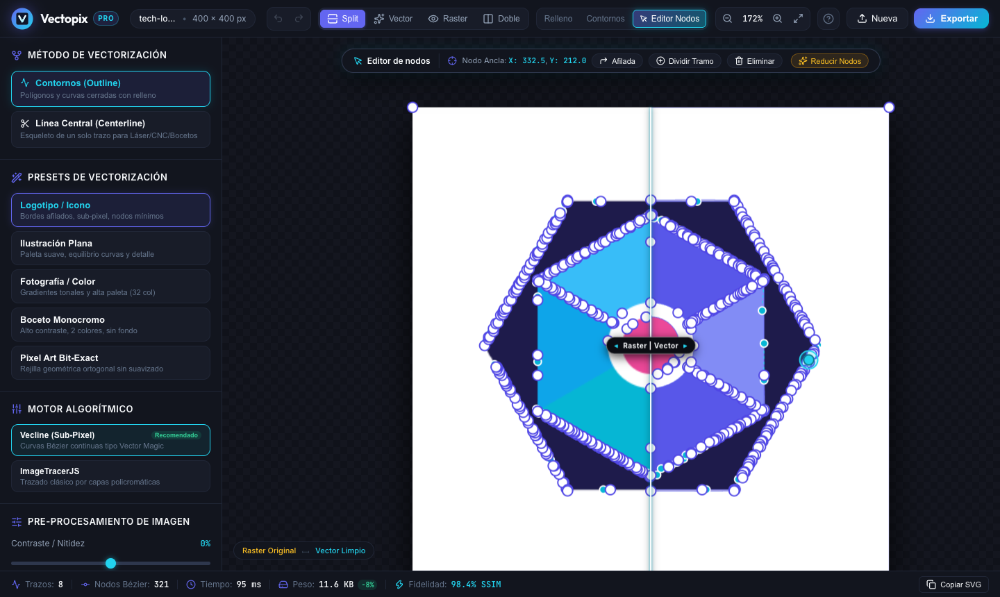
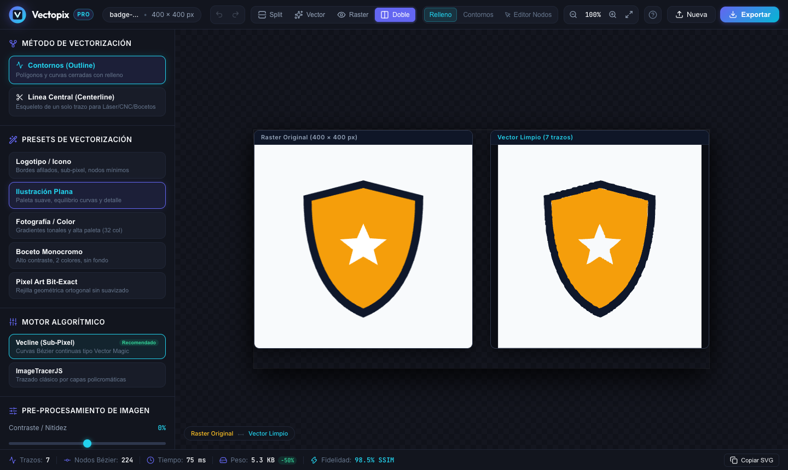
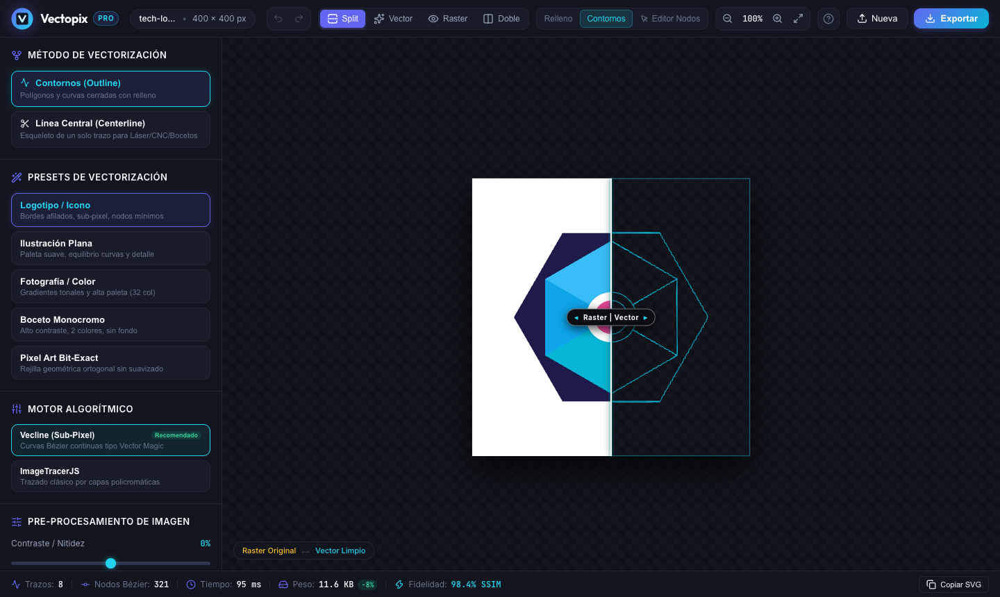
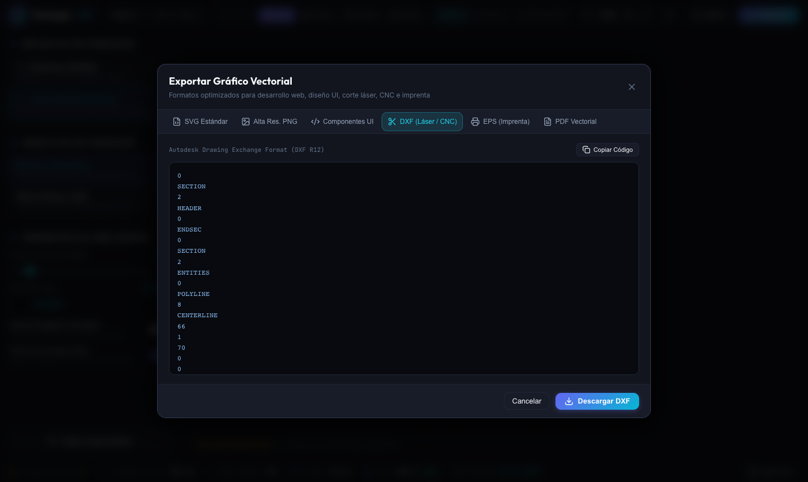

<p align="center">
  
</p>

<h1 align="center">Vectopix</h1>

<p align="center">
  Convierte imágenes raster (PNG, JPG, WebP, BMP) en vectores limpios — <b>SVG, DXF, EPS y PDF</b> —
  directamente en el navegador. Sin servidores: tus imágenes nunca salen de tu equipo.
</p>

<p align="center">
  <a href="https://github.com/jgestal/Vectopix/actions/workflows/ci.yml"></a>
  
  
  
  
</p>

<p align="center">
  <a href="https://jgestal.github.io/Vectopix/"><b>▶ Probar la app en el navegador</b></a>
</p>

<p align="center">
  
</p>

## Características

- **Vectorización sub-píxel** con [vecline](https://www.npmjs.com/package/vecline): cuantización de color en espacio Oklab, reconstrucción del anti-aliasing y ajuste de curvas Bézier. ImageTracerJS está disponible como motor alternativo.
- **Dos métodos de trazado**
  - *Contornos*: regiones de color rellenas, para logos, ilustraciones, pixel art o fotos.
  - *Línea central*: trazos de un solo hilo, para corte láser, plotters, CNC y bocetos.
- **Presets** para logotipos, ilustración plana, fotografía, bocetos, pixel art y centerline, más control fino de colores, tolerancia, suavizado, esquinas, área mínima, contraste y reducción de ruido.
- **Re-trazado automático**: al cambiar cualquier ajuste se vuelve a vectorizar (con *debounce*, así que mover un slider no satura el motor).
- **Fidelidad medida, no estimada**: el SVG resultante se renderiza y se compara con la imagen original mediante SSIM.
- **Comparación visual**: cortinilla raster/vector, vista doble lado a lado, solo vector o solo raster, modo contornos y rejilla de píxeles al hacer zoom.
- **Editor de nodos Bézier**: mueve anclas y tiradores, alterna curva/esquina, divide tramos, elimina nodos y simplifica trazados, con deshacer y rehacer. Admite todos los comandos de trazado SVG, arcos incluidos, y guarda las ediciones en formato compacto para que el archivo no engorde.
- **Gestión de paleta**: sustituye un color en todo el gráfico (incluidos los degradados) o hazlo transparente.
- **Exportación**: SVG optimizado, PNG a @1x–@8x, componentes React/Vue/Svelte, DXF (láser/CNC), EPS (imprenta) y PDF vectorial. Todos los formatos incluyen tus ediciones de nodos y colores.
- **Todo en local**: el motor corre en un Web Worker, así que la interfaz no se bloquea, y no hay ninguna subida a servidor.

## Capturas

<table>
  <tr>
    <td width="50%"></td>
    <td width="50%"></td>
  </tr>
  <tr>
    <td align="center"><b>Portada</b>: arrastra, pega o prueba una muestra</td>
    <td align="center"><b>Editor de nodos</b>: anclas y tiradores Bézier</td>
  </tr>
  <tr>
    <td></td>
    <td></td>
  </tr>
  <tr>
    <td align="center"><b>Vista doble</b>: original y vector lado a lado</td>
    <td align="center"><b>Modo contornos</b>: la estructura de los trazados</td>
  </tr>
  <tr>
    <td></td>
    <td></td>
  </tr>
  <tr>
    <td align="center"><b>Línea central</b>: trazos de un solo hilo para láser y CNC</td>
    <td align="center"><b>Exportación</b>: SVG, PNG, componentes, DXF, EPS y PDF</td>
  </tr>
</table>

## Empezar

Requisitos: Node.js 20.19+ o 22.12+ (lo que pide Vite 8).

```bash
git clone https://github.com/jgestal/Vectopix.git
cd Vectopix
npm install
npm run dev
```

Abre la URL que muestra Vite (normalmente `http://localhost:5173`). Arrastra una imagen, pégala con <kbd>Ctrl</kbd>/<kbd>⌘</kbd>+<kbd>V</kbd> o prueba con una de las muestras incluidas.

### Scripts

| Comando              | Qué hace                                         |
| -------------------- | ------------------------------------------------ |
| `npm run dev`        | Servidor de desarrollo con HMR                   |
| `npm run build`      | Comprobación de tipos y build de producción en `dist/` |
| `npm run preview`    | Sirve el build de producción                     |
| `npm test`           | Ejecuta los tests (Vitest)                       |
| `npm run test:watch` | Tests en modo observación                        |
| `npm run lint`       | Lint con Oxlint                                  |

## Atajos de teclado

| Atajo                                   | Acción                                        |
| --------------------------------------- | --------------------------------------------- |
| <kbd>⌘/Ctrl</kbd> + <kbd>Z</kbd>        | Deshacer                                      |
| <kbd>⌘/Ctrl</kbd> + <kbd>⇧</kbd> + <kbd>Z</kbd> · <kbd>⌘/Ctrl</kbd> + <kbd>Y</kbd> | Rehacer |
| <kbd>⌘/Ctrl</kbd> + <kbd>C</kbd>        | Copiar el SVG (si no hay texto seleccionado)  |
| <kbd>⌘/Ctrl</kbd> + <kbd>V</kbd>        | Cargar una imagen desde el portapapeles       |
| <kbd>N</kbd> / <kbd>E</kbd>             | Editor de nodos                               |
| <kbd>W</kbd>                            | Modo contornos (wireframe)                    |
| <kbd>S</kbd>                            | Alternar cortinilla / solo vector             |
| <kbd>D</kbd>                            | Vista doble lado a lado                       |
| <kbd>Espacio</kbd> + arrastrar          | Desplazar el lienzo                           |
| Rueda / pellizco                        | Zoom centrado en el cursor                    |
| <kbd>Supr</kbd> / <kbd>⌫</kbd>          | Eliminar el nodo seleccionado                 |
| <kbd>?</kbd>                            | Mostrar todos los atajos                      |

## Arquitectura

```
src/
├── App.tsx                     Estado de la app: imagen, opciones, resultado, historial
├── config/presets.ts           Opciones por defecto y tabla única de presets
├── services/
│   ├── vectorEngine.ts         Motor puro (sin DOM ni worker): trazado, exportación y SSIM
│   └── vectorWorkerClient.ts   Cliente del worker: peticiones, progreso y cancelación
├── workers/vector.worker.ts    Envoltorio fino del motor dentro del Web Worker
├── components/                 Header, Sidebar, Viewport (lienzo y editor de nodos), modales…
└── utils/
    ├── pathParser.ts           Parser y editor de trazados SVG (anclas, tiradores, simplificación)
    ├── centerlineExport.ts     Escritores DXF / EPS / PDF para trazados de línea central
    ├── svgExport.ts            SVG (editado) → geometría para DXF / EPS / PDF
    ├── fidelity.ts             Renderiza el SVG para medir su fidelidad frente al original
    └── …                       Preprocesado, paleta, exportación y carga de imágenes
```

**Cómo fluye una vectorización**

1. La imagen se decodifica en un `<canvas>`. Si supera los 4 MP se reduce, para que el trazado siga siendo fluido.
2. Los píxeles se envían (transferidos, sin copias) al Web Worker, que aplica el preprocesado y traza con vecline o ImageTracerJS mientras informa del progreso.
3. Si llega una petición nueva mientras otra está en curso, el worker se termina y se crea uno nuevo. Es una cancelación real: el trabajo antiguo no sigue consumiendo CPU.
4. Con el SVG ya en pantalla, se renderiza en segundo plano y el worker calcula su SSIM frente al original.
5. DXF, EPS y PDF solo se generan cuando abres su pestaña de exportación. Si no has editado nada, el worker los construye con la geometría exacta del trazado. Si has editado algo (o usas ImageTracer), se construyen a partir del SVG actual, para que incluyan todos los cambios.

El editor de nodos solo reescribe el atributo `d` de los trazados que modificas. Todo lo demás (degradados, `<defs>`, figuras básicas, grupos y atributos) se conserva tal cual. Un trazado que no se pueda leer entero nunca se reescribe.

## Despliegue

Cada push a `main` ejecuta los tests y publica el build en GitHub Pages (`.github/workflows/deploy.yml`). Las rutas del build son relativas (`base: './'`), así que el mismo `dist/` funciona en la raíz de un dominio o en cualquier subruta.

## Limitaciones conocidas

- En las exportaciones DXF, EPS y PDF a partir de un SVG editado, los degradados se aplanan al color medio de sus paradas y no se aplican atributos `transform`. Los SVG que genera la app no usan transformaciones.
- El SSIM se mide a un máximo de 512 px en el lado mayor: es un indicador fiable de fidelidad, no una comparación a resolución completa.

## Tecnologías

[React 19](https://react.dev) · [TypeScript](https://www.typescriptlang.org) · [Vite](https://vite.dev) · [vecline](https://www.npmjs.com/package/vecline) · [ImageTracerJS](https://github.com/jankovicsandras/imagetracerjs) · [lucide-react](https://lucide.dev) · [Vitest](https://vitest.dev) · [Oxlint](https://oxc.rs)

## Licencia

[MIT](LICENSE) © 2026 Juan Gestal
