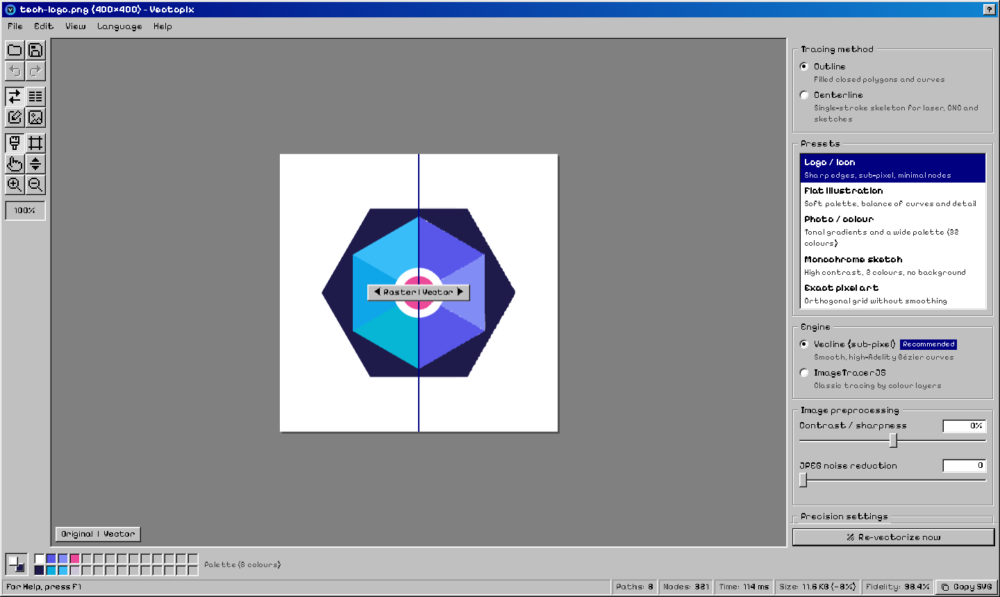
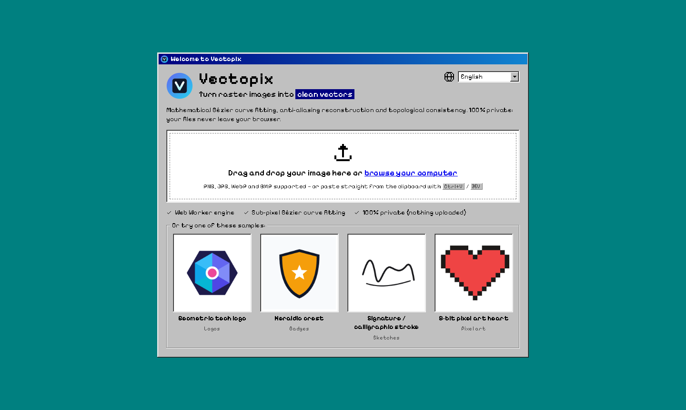
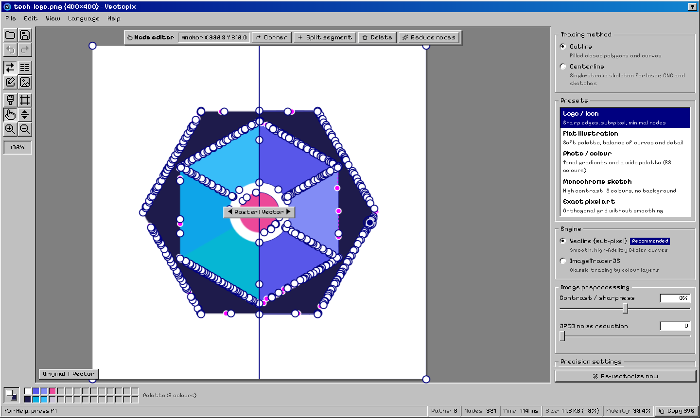
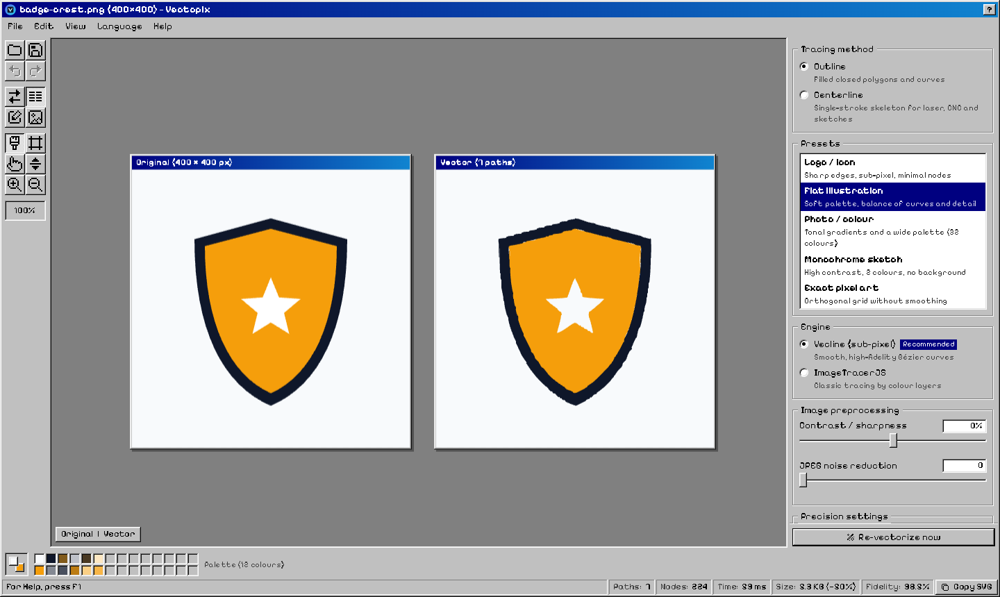
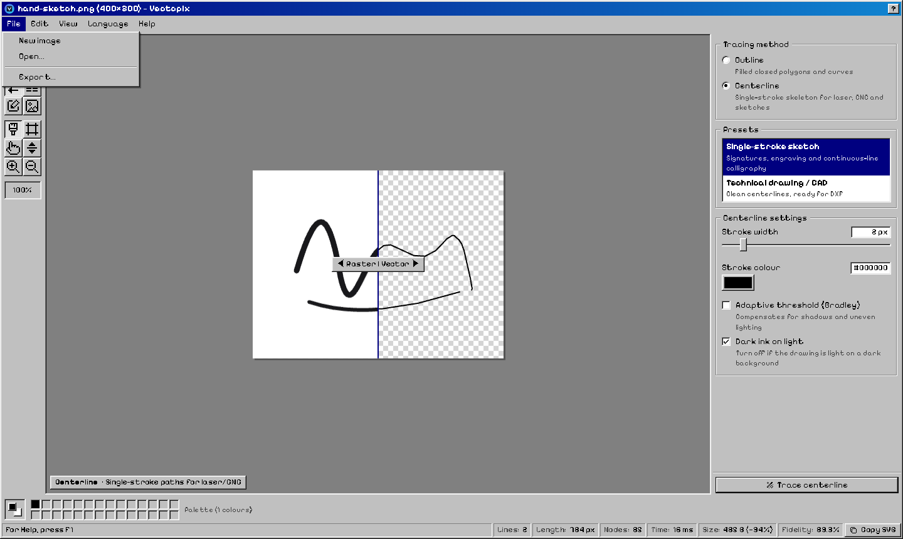
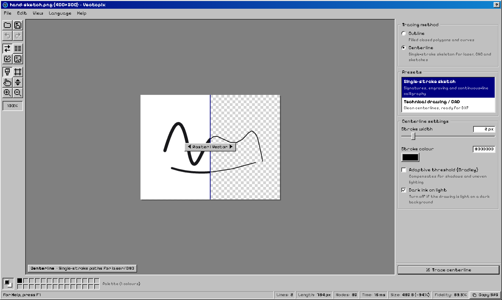
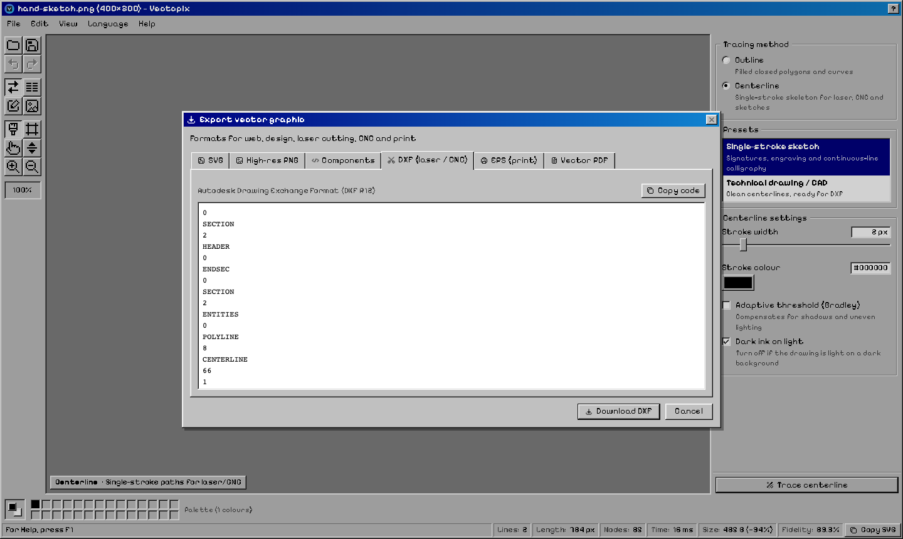

<p align="center">
  
</p>

<h1 align="center">Vectopix</h1>

<p align="center">
  <b>English</b> · <a href="README.es.md">Español</a>
</p>

<p align="center">
  Turn raster images (PNG, JPG, WebP, BMP) into clean vectors — <b>SVG, DXF, EPS and PDF</b>.
  It runs entirely on your machine, in the browser or as a desktop app, and it looks like a 90s paint program:
  your images never leave your computer.
</p>

<p align="center">
  <a href="https://github.com/jgestal/Vectopix/actions/workflows/ci.yml"></a>
  <a href="https://github.com/jgestal/Vectopix/releases/latest"></a>
  
  
</p>

<p align="center">
  <a href="https://jgestal.github.io/Vectopix/"><b>▶ Try it in your browser</b></a>
  &nbsp;·&nbsp;
  <a href="https://github.com/jgestal/Vectopix/releases/latest"><b>⬇ Download for macOS, Windows and Linux</b></a>
</p>

<p align="center">
  
</p>

## Features

- **Retro interface** inspired by Windows 98 Paint: menu bar, tool box, colour box, status bar, bevelled dialogs, pixel font and pixel-art icons.
- **Sub-pixel vectorization** powered by [vecline](https://www.npmjs.com/package/vecline): colour quantization in Oklab space, anti-aliasing reconstruction and Bézier curve fitting. ImageTracerJS is available as an alternative engine.
- **Two tracing methods**
  - *Outline*: filled colour regions, for logos, illustrations, pixel art or photos.
  - *Centerline*: single-stroke paths, for laser cutters, plotters, CNC and sketches.
- **Presets** for logos, flat illustration, photos, sketches, pixel art and centerline, plus fine control over colours, tolerance, smoothing, corners, minimum area, contrast and noise reduction.
- **Automatic re-tracing**: changing any setting re-vectorizes the image (debounced, so dragging a slider doesn't flood the engine).
- **Measured fidelity, not estimated**: the resulting SVG is rendered and compared with the original image using SSIM.
- **Any image, any way**: drop or paste PNG, JPG, WebP, GIF, AVIF, BMP, ICO, SVG, TGA or PPM/PGM; drag a built-in sample or an image from another web page onto the drop zone.
- **Visual comparison**: before/after split, side-by-side, vector only or raster only, outline mode and a pixel grid when zoomed in.
- **Bézier node editor**: move anchors and handles, toggle curve/corner, split segments, delete nodes and simplify paths, with undo and redo. It handles every SVG path command, arcs included, and stores edits compactly so the file doesn't grow.
- **Palette management**: the colour box shows the traced palette; click a colour to replace it across the whole drawing (gradients included) or make it transparent.
- **Export**: optimized SVG, PNG at @1x–@8x, React/Vue/Svelte components, DXF (laser/CNC), EPS (print) and vector PDF. Every format includes your node and colour edits.
- **8 languages**: English, Spanish, German, French, Italian, Portuguese, Chinese and Japanese. The app picks your system language and remembers your choice.
- **Fully local**: the engine runs in a Web Worker, so the interface never freezes, and nothing is uploaded anywhere. Fonts are bundled too, so the desktop app works offline.

## Screenshots

<table>
  <tr>
    <td width="50%"></td>
    <td width="50%"></td>
  </tr>
  <tr>
    <td align="center"><b>Landing</b>: drop, paste or try a sample</td>
    <td align="center"><b>Node editor</b>: anchors and Bézier handles</td>
  </tr>
  <tr>
    <td></td>
    <td></td>
  </tr>
  <tr>
    <td align="center"><b>Dual view</b>: original and vector side by side</td>
    <td align="center"><b>Menus</b>: every action, Windows 98 style</td>
  </tr>
  <tr>
    <td></td>
    <td></td>
  </tr>
  <tr>
    <td align="center"><b>Centerline</b>: single-stroke paths for laser and CNC</td>
    <td align="center"><b>Export</b>: SVG, PNG, components, DXF, EPS and PDF</td>
  </tr>
</table>

## Download

Every [release](https://github.com/jgestal/Vectopix/releases/latest) includes:

| Platform | File |
| --- | --- |
| macOS (Apple Silicon) | `Vectopix-<version>-mac-arm64.dmg` |
| macOS (Intel) | `Vectopix-<version>-mac-x64.dmg` |
| Windows | `Vectopix-<version>-windows-setup.exe` (installer) or `-windows-portable.exe` |
| Linux | `Vectopix-<version>-linux-x86_64.AppImage` or `-linux-amd64.deb` |
| Web (self-hosting) | `Vectopix-<version>-web.zip`: upload it to any static web server |

The apps are not signed with a paid developer certificate, so the first launch needs a confirmation:

- **macOS**: open the app, then go to *System Settings → Privacy & Security* and click **Open Anyway**.
- **Windows**: in the SmartScreen dialog, click **More info → Run anyway**.
- **Linux**: make the AppImage executable (`chmod +x Vectopix-*.AppImage`) and run it.

## Development

Requirements: Node.js 20.19+ or 22.12+ (required by Vite 8).

```bash
git clone https://github.com/jgestal/Vectopix.git
cd Vectopix
npm install
npm run dev
```

Open the URL Vite prints (usually `http://localhost:5173`). Drop an image, paste one with <kbd>Ctrl</kbd>/<kbd>⌘</kbd>+<kbd>V</kbd> or try one of the built-in samples.

| Command                | What it does                                              |
| ---------------------- | --------------------------------------------------------- |
| `npm run dev`          | Development server with HMR                               |
| `npm run build`        | Type-check and production build into `dist/`              |
| `npm run preview`      | Serve the production build                                |
| `npm test`             | Run the tests (Vitest)                                    |
| `npm run lint`         | Lint with Oxlint                                          |
| `npm run desktop`      | Build and open the desktop app (Electron)                 |
| `npm run dist:desktop` | Build the desktop installers for your OS into `release/`  |

### Publishing a release

1. Bump `version` in `package.json` and commit.
2. Tag the commit and push the tag: `git tag v1.2.3 && git push origin v1.2.3`.
3. The **Release** workflow builds the apps on macOS, Windows and Linux plus the web zip, and publishes them as a GitHub release.

Every push to `main` also runs the tests and deploys the web version to GitHub Pages.

## Keyboard shortcuts

| Shortcut                                | Action                                         |
| --------------------------------------- | ---------------------------------------------- |
| <kbd>⌘/Ctrl</kbd> + <kbd>Z</kbd>        | Undo                                           |
| <kbd>⌘/Ctrl</kbd> + <kbd>⇧</kbd> + <kbd>Z</kbd> · <kbd>⌘/Ctrl</kbd> + <kbd>Y</kbd> | Redo |
| <kbd>⌘/Ctrl</kbd> + <kbd>C</kbd>        | Copy the SVG (when no text is selected)        |
| <kbd>⌘/Ctrl</kbd> + <kbd>V</kbd>        | Load an image from the clipboard               |
| <kbd>N</kbd> / <kbd>E</kbd>             | Node editor                                    |
| <kbd>W</kbd>                            | Outline (wireframe) mode                       |
| <kbd>S</kbd>                            | Toggle split / vector only                     |
| <kbd>D</kbd>                            | Dual (side-by-side) view                       |
| <kbd>Space</kbd> + drag                 | Pan the canvas                                 |
| Wheel / pinch                           | Zoom around the cursor                         |
| <kbd>Del</kbd> / <kbd>⌫</kbd>           | Delete the selected node                       |
| <kbd>F1</kbd> / <kbd>?</kbd>            | Show every shortcut                            |

## Architecture

```
src/
├── App.tsx                     App state: image, options, result, history
├── i18n/                       Translations: lightweight runtime, one file per language
├── config/presets.ts           Default options and the single preset table
├── services/
│   ├── vectorEngine.ts         Pure engine (no DOM, no worker): tracing, export, SSIM
│   └── vectorWorkerClient.ts   Worker client: requests, progress and cancellation
├── workers/vector.worker.ts    Thin wrapper around the engine inside the Web Worker
├── components/                 Menu bar, Toolbox, Viewport (canvas and node editor), properties, dialogs…
│   └── retro/                  Windows 98 building blocks: window, dialog, menu bar
└── utils/
    ├── pathParser.ts           SVG path parser and editor (anchors, handles, simplification)
    ├── svgExport.ts            (Edited) SVG → geometry for DXF / EPS / PDF
    ├── centerlineExport.ts     DXF / EPS / PDF writers for centerline traces
    ├── fidelity.ts             Renders the SVG to measure its fidelity against the source
    └── …                       Preprocessing, palette, export and image loading
electron/main.cjs               Desktop shell: serves dist/ from a private app:// origin
```

**How a vectorization flows**

1. The image is decoded into a `<canvas>`. Anything above 4 MP is downscaled so tracing stays smooth.
2. The pixels are transferred (zero-copy) to the Web Worker, which preprocesses and traces them with vecline or ImageTracerJS while reporting progress.
3. If a new request arrives while one is running, the worker is terminated and a fresh one started: a real cancellation, the old job stops using the CPU.
4. Once the SVG is on screen, it is rendered in the background and the worker computes its SSIM against the original.
5. DXF, EPS and PDF are only built when you open their export tab: from the exact trace geometry when nothing was edited, or from the current SVG otherwise, so every change is included.

**Translations**: `src/i18n/locales/es.ts` is the reference catalogue. TypeScript requires every other language to define exactly the same keys, and a test checks that every translation keeps the same `{placeholders}`. To add a language, copy `en.ts`, translate it and register it in `src/i18n/core.ts`.

## Known limitations

- When DXF, EPS or PDF are exported from an edited SVG, gradients are flattened to the average colour of their stops and `transform` attributes are not applied (the SVGs the app produces don't use them).
- SSIM is measured at up to 512 px on the longest side: a reliable fidelity indicator, not a full-resolution comparison.

## Tech stack

[React 19](https://react.dev) · [TypeScript](https://www.typescriptlang.org) · [Vite](https://vite.dev) · [vecline](https://www.npmjs.com/package/vecline) · [ImageTracerJS](https://github.com/jankovicsandras/imagetracerjs) · [Electron](https://www.electronjs.org) · [pixelarticons](https://pixelarticons.com) · [Pixelify Sans](https://fontsource.org/fonts/pixelify-sans) · [Vitest](https://vitest.dev) · [Oxlint](https://oxc.rs)

## License

[MIT](LICENSE) © 2026 Juan Gestal
